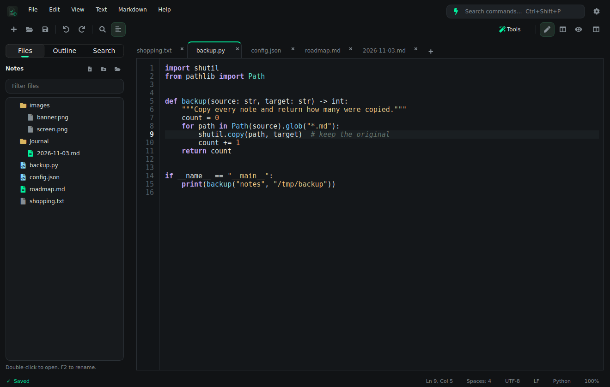
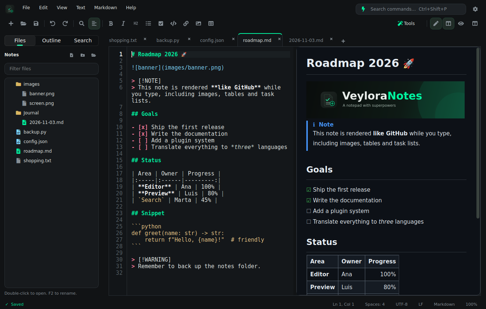
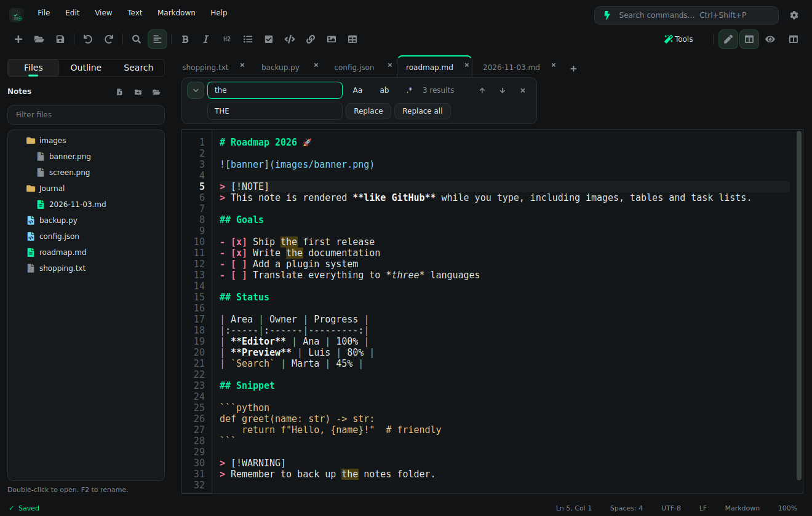
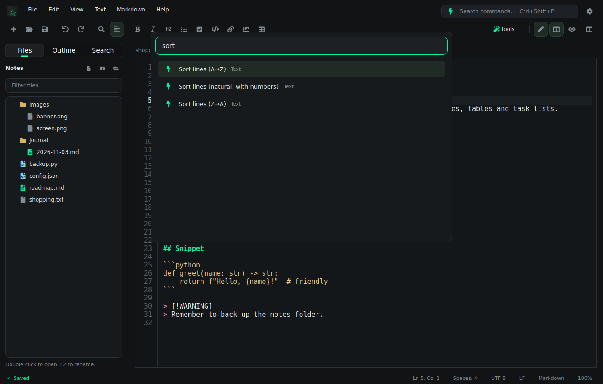
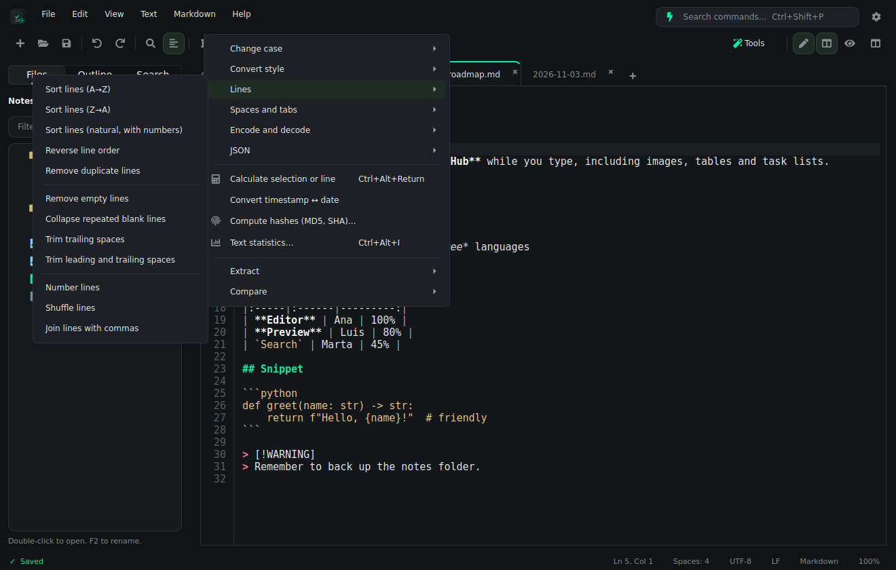
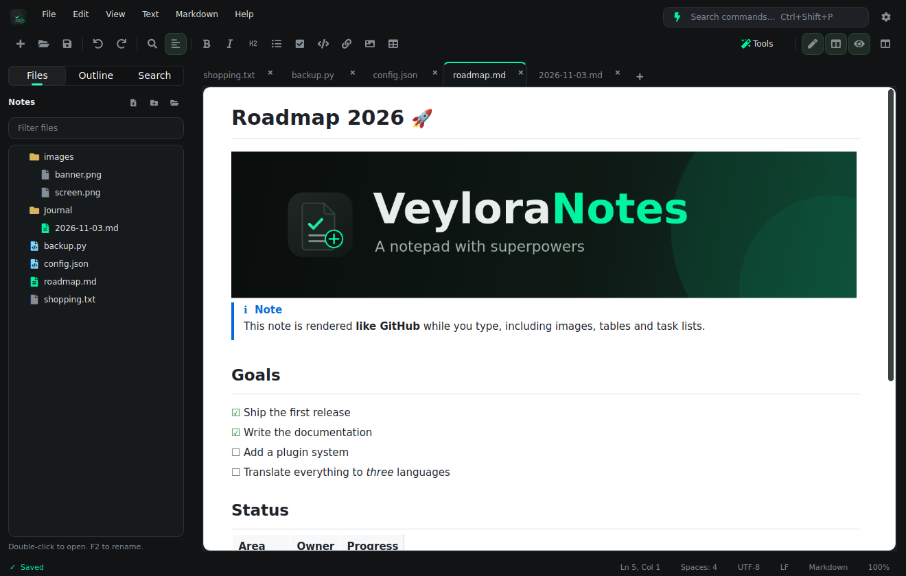

<p align="center">
  
</p>

<p align="center">
  <b>A notepad with superpowers.</b><br>
  Tabs, find &amp; replace, a command palette, dozens of text tools and a GitHub-style Markdown preview, in one fast window.
</p>

<p align="center">
  
  
  
  
</p>

**Made with 💚 in Andalusia, Spain.**

---

## 📑 Table of Contents

- [Why VeyloraNotes](#-why-veyloranotes)
- [Screenshots](#-screenshots)
- [Features](#-features)
- [Text tools](#-text-tools)
- [Markdown preview](#-markdown-preview)
- [Keyboard shortcuts](#-keyboard-shortcuts)
- [Install and run](#-install-and-run)
- [Build packages](#-build-packages)
- [Your data and privacy](#-your-data-and-privacy)
- [Project structure](#-project-structure)
- [Tests](#-tests)
- [License](#-license)

---

## ✨ Why VeyloraNotes

It starts as simple as the Windows Notepad: you open it and type. But when you need more, it is all there: a
searchable command palette, multi-tab editing, regular-expression replace, line tools, JSON, Base64, hashes, a safe
calculator, a diff against your clipboard… and when the note is Markdown you can see it **rendered like on GitHub**, with
images, tables, task lists and highlighted code.

---

## 📸 Screenshots

| | |
|:--|:--|
|  |  |
| **Editor** with tabs, line numbers and syntax highlighting | **Split view**: edit on the left, GitHub-style preview on the right |
|  |  |
| **Find & replace** with regex, whole word and live highlights | **Command palette** (`Ctrl+Shift+P`): every tool is one search away |
|  |  |
| **Text tools** menu | **Light preview** theme |

---

## 🧰 Features

### Notepad essentials

| Feature | Details |
|:--------|:--------|
| **Tabs** | Drag to reorder, `+` for a new tab, a dot marks unsaved changes, context menu (close others, close to the right, copy path, show in folder). |
| **Never lose a word** | Unsaved text (even in “Untitled” tabs) is restored the next time you open the app, like the Windows 11 Notepad. Can be switched off in Settings. |
| **Any text file** | UTF-8, UTF-8 with BOM, UTF-16, Windows-1252, ISO-8859-1… Encoding and line endings (LF / CRLF / CR) are detected and **preserved on save**. You can change both from the status bar. |
| **External changes** | If a file changes on disk it is reloaded (or you are asked if you have unsaved edits). |
| **Find & replace** | Match case, whole word, regular expressions with `$1` / `\1` groups, live highlights and counter, one-step undo for “replace all”. |
| **Folder search** | Search the text of every file in your notes folder and jump to the line. |
| **Editing helpers** | Line numbers, current-line highlight, bracket matching, smart Home, auto-indent, duplicate / delete / move / join lines, indent, comment toggle per language, Ctrl+click on links, zoom per tab. |
| **Syntax highlighting** | Markdown, JSON, Python, JavaScript, TypeScript, HTML, XML, CSS, YAML, TOML/INI, Shell, C, C++, Java, C#, Go, Rust, PHP, Ruby, Lua, SQL and diff. |
| **Sidebar** | File explorer for your notes folder (create, rename, delete to trash), document outline and folder search. |
| **Notes workflow** | “Today's note” creates a dated Markdown note (`Journal/2026-11-03.md`; the folder is called `Diario` in Spanish) with one shortcut. |
| **Open from anywhere** | Drag and drop files, `veyloranotes file.md` from the terminal, or “Open with” from your file manager (text and Markdown associations are registered). |
| **Focus** | Full screen and a distraction-free focus mode. |
| **Instant language switch** | English and Spanish, applied without restarting. |

### Command palette

`Ctrl+Shift+P` lists **every command** with its shortcut. Type `:42` to jump to a line. `Ctrl+P` opens any file from
your notes folder, recent files or open tabs.

---

## 🛠️ Text tools

Text tools work on the selection (or on the whole document when nothing is selected) and each one is a single undo
step. *Insert* tools add text at the cursor.

| Group | Tools |
|:------|:------|
| **Case** | UPPERCASE, lowercase, Title Case, Sentence case, invert · camelCase, PascalCase, snake_case, kebab-case, CONSTANT_CASE, URL slug · remove accents |
| **Lines** | Sort (A→Z, Z→A, natural with numbers), reverse, remove duplicates, remove empty lines, collapse blank lines, trim spaces, number lines, shuffle, join with commas |
| **Spaces** | Tabs ↔ spaces |
| **Encode / decode** | Base64, URL, HTML entities, hexadecimal, ROT13 |
| **JSON** | Format, minify, validate (jumps to the error line) |
| **Calculate** | Evaluates `12*3+4`, `sqrt(16)`, `20%`… on the selection or the current line. It never uses `eval`. |
| **Hashes** | MD5, SHA-1, SHA-256, SHA-512 with copy buttons |
| **Statistics** | Words, characters, lines, paragraphs, sentences, reading time and most frequent words |
| **Extract** | Links, emails or numbers into a new tab |
| **Compare** | Diff against the saved file or against the clipboard |
| **Insert** | Date and time (`F5`), Unix timestamp, UUID, secure password, Lorem ipsum, color picker (hex) |
| **Timestamps** | Unix ↔ readable date |

---

## 📝 Markdown preview

Switch between **editor**, **split** and **preview** with `Ctrl+Shift+V`. Scrolling is synchronized. The preview follows
the GitHub look in dark or light.

| Supported | Notes |
|:----------|:------|
| Headings, emphasis, strikethrough, links, quotes, rules | Anchor links such as `[Features](#features)` scroll the preview; links to other `.md` files open in a new tab. |
| Tables | Alignment and striped rows. |
| Task lists | `- [x]` / `- [ ]`, toggled in the editor with `Ctrl+Enter`. |
| Alerts | `> [!NOTE]`, `[!TIP]`, `[!IMPORTANT]`, `[!WARNING]`, `[!CAUTION]` |
| Fenced code | Highlighted with Pygments for hundreds of languages. |
| Images | Local (relative paths), `data:` URIs and remote images, SVG badges included, scaled to the window. |
| Raw HTML | `<p align="center">`, ``, `<kbd>`, `<details>` (shown expanded)… |
| Front matter | Shown as a small table, like GitHub. |

Markdown helpers: bold, italic, headings, lists, quotes, code blocks, links, **insert image**, **paste an image from the
clipboard** (saved to an `images/` folder next to the note), **insert / format tables**, **generate a table of contents**,
and automatic continuation of lists when you press Enter. Export to **HTML** or **PDF** from the *File* menu.

> [!NOTE]
> The preview is rendered with Qt's rich text engine, so it is very close to GitHub but not pixel-identical.
> Mermaid diagrams and math are shown as their source, and `<details>` blocks are always expanded.

---

## ⌨️ Keyboard shortcuts

`Help → Keyboard shortcuts` (`F1`) shows the complete list. The most useful ones:

| Shortcut | Action |
|:---------|:-------|
| `Ctrl+Shift+P` | Command palette |
| `Ctrl+P` | Go to file |
| `Ctrl+N` / `Ctrl+O` / `Ctrl+S` | New tab / Open / Save |
| `Ctrl+Shift+S` / `Ctrl+Alt+S` | Save as / Save all |
| `Ctrl+W` / `Ctrl+PgUp` / `Ctrl+PgDn` | Close tab / Previous tab / Next tab |
| `Ctrl+F` / `Ctrl+H` / `F3` | Find / Replace / Find next |
| `Ctrl+Shift+F` | Search in the notes folder |
| `Ctrl+G` | Go to line |
| `Ctrl+D` / `Ctrl+Shift+K` | Duplicate line / Delete line |
| `Alt+↑` / `Alt+↓` | Move line up / down |
| `Ctrl+/` | Toggle comment |
| `Ctrl+Shift+U` / `Ctrl+U` | UPPERCASE / lowercase |
| `Ctrl+Alt+Enter` | Calculate selection or line |
| `Ctrl+Shift+V` | Cycle editor / split / preview |
| `Ctrl+B` / `Ctrl+I` / `Ctrl+K` | Bold / Italic / Link (Markdown) |
| `Ctrl+Alt+V` | Paste image from clipboard (Markdown) |
| `Ctrl+Alt+D` | Today's note |
| `Alt+Z` | Word wrap |
| `Ctrl++` / `Ctrl+-` / `Ctrl+0` | Zoom in / out / reset |
| `F11` / `Ctrl+Alt+Z` | Full screen / Focus mode |
| `Ctrl+,` | Settings |

---

## 🚀 Install and run

Requirements: Python 3.10 or newer.

```bash
git clone https://github.com/VeyloraLabs/VeyloraNotes.git
cd VeyloraNotes
./run.sh
```

`run.sh` creates a virtual environment, installs [`requirements.txt`](requirements.txt) and starts the app. You can pass
files to open:

```bash
./run.sh ~/Documents/notes/todo.md
```

---

## 📦 Build packages

```bash
./packaging/build.sh
```

Produces a portable `.tar.gz`, a `.deb`, an `.rpm` and an `AppImage` (when the required tools are installed) in
`packaging/compilation/Linux-<arch>/`, with `SHA256SUMS`. Use `-t tar,deb` to choose targets and `-v X.Y.Z` to set the
version.

---

## 🔒 Your data and privacy

Your notes are plain files in a folder you choose (default `~/Documents/VeyloraNotes`). Nothing is uploaded anywhere.

| What | Where |
|:-----|:------|
| Settings | `~/.config/VeyloraLabs/VeyloraNotes.conf` |
| Recovered tabs (unsaved text) | `~/.local/share/VeyloraLabs/VeyloraNotes/session/` |
| Downloaded preview images | `~/.cache/VeyloraLabs/VeyloraNotes/images/` |

The only network connections are:

- **Remote images in the Markdown preview** (badges, screenshots hosted on the web). They are downloaded when you open
  a preview and cached for a week. Turn this off in *Settings → Preview → Load images from the internet* and no
  connection is made.
- **Update check**: one request to the GitHub releases API at startup, with no personal data. It can be switched off in
  *Settings → General*.

---

## 🗂️ Project structure

```text
VeyloraNotes/
├── main.py                  Entry point
├── run.sh                   Creates the venv and runs the app
├── requirements.txt
├── assets/                  Icon and banner
├── docs/screenshots/        Images used in this README
├── packaging/               build.sh + desktop file (tar.gz, deb, rpm, AppImage)
├── tests/                   Core, editor and full-window tests (run headless)
└── app/
    ├── core/                Pure Python logic (no UI)
    │   ├── document_io.py       Encoding and line-ending aware file reading and writing
    │   ├── text_tools.py        Case, lines, encode/decode, JSON, hashes, statistics…
    │   ├── calculator.py        Safe math evaluator
    │   ├── markdown_tools.py    Tables, outline, table of contents, tasks, lists
    │   ├── markdown_html.py     Markdown → HTML for the GitHub-style preview
    │   ├── languages.py         Syntax definitions
    │   └── session.py           Recovery of unsaved tabs
    └── gui/                 Qt widgets
        ├── main_window.py       Window, tabs, files and session
        ├── commands.py          Every command, shortcut and menu
        ├── editor.py            Code editor widget
        ├── highlighter.py       Syntax highlighting
        ├── preview.py           Markdown preview and image loading
        ├── find_bar.py          Find and replace
        ├── sidebar.py           Files, outline and folder search
        └── command_palette.py   Command palette
```

---

## 🧪 Tests

```bash
source .venv/bin/activate
cd tests
python test_core.py
python test_editor.py
python test_app.py
```

They run without a display (`QT_QPA_PLATFORM=offscreen`). `test_app.py` triggers every command of the application and
fails on any exception.

---

## 📄 License

VeyloraNotes is released under the [GNU General Public License v3.0](LICENSE).
The source code can be read, modified and redistributed under its terms.

The interface uses [PySide6-Fluent-Widgets](https://github.com/zhiyiYo/PyQt-Fluent-Widgets), which has separate
non-commercial and commercial licensing terms. Review [THIRD_PARTY_NOTICES.md](THIRD_PARTY_NOTICES.md) and each
dependency's terms before redistributing or using the application commercially.

---

## 🙏 Acknowledgements

[Qt for Python](https://wiki.qt.io/Qt_for_Python) · [PySide6-Fluent-Widgets](https://github.com/zhiyiYo/PyQt-Fluent-Widgets) ·
[QtAwesome](https://github.com/spyder-ide/qtawesome) · [markdown-it-py](https://github.com/executablebooks/markdown-it-py) ·
[Pygments](https://pygments.org/)

---

<p align="center">Made with 💚 in Andalusia, Spain.</p>
